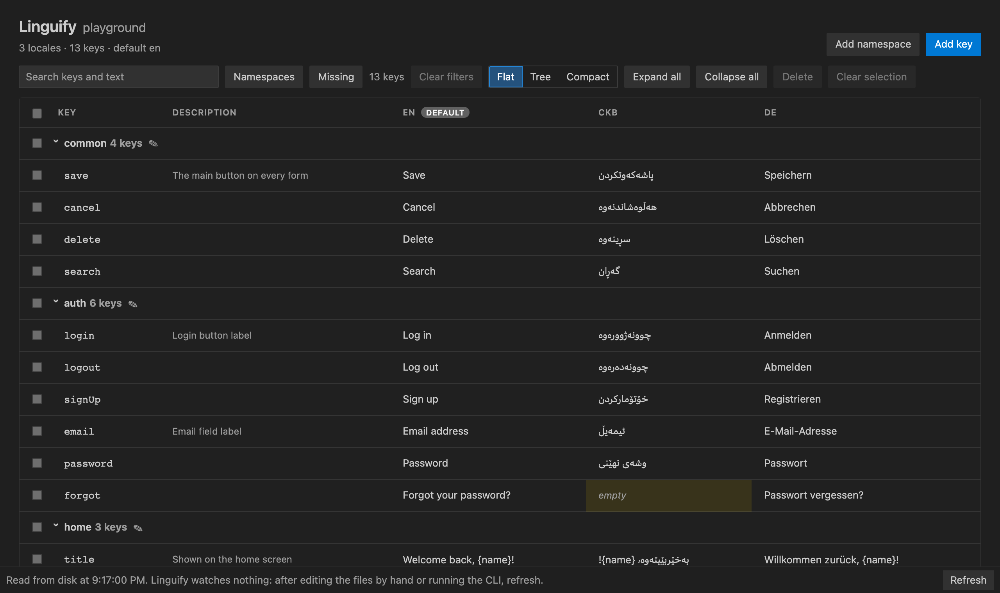

# Linguify for VS Code

Your app's translation files as a table, in an editor panel: every key in every locale side by side, what
each locale is missing marked, and every change written to the files as you make it — added, renamed or
removed in every locale at once.

It is [linguify](https://www.npmjs.com/package/linguify)'s own engine, inside the editor: the same rules,
the same files, the same results as the command line and the studio. Nothing else to install.

## Start

Open a folder that has a `linguify.config.json` — or create one with `npx linguify init` — then run
**Linguify: Open** from the command palette.

## The panel

- **Flat, tree and compact views**, sections by namespace, groups opened and closed.
- **Edit in place**: click a text or press Enter, Enter saves, Escape cancels. Descriptions too, when the
  project keeps them.
- **Search, filter and sort**: a search over keys and texts, a filter for what a locale is missing, one for
  namespaces, and any column sorted — on screen only, never in the files.
- **Add, select and delete** keys; **add and rename** namespaces. What would be refused is said before
  anything is sent.
- **The keyboard throughout**: the table is one Tab stop, the arrow keys move inside it, Home and End to a
  row's ends.
- **The editor's own look**: light, dark and high contrast themes, followed as you switch.

The panel watches nothing. If the files change on disk — a hand edit, a `git pull`, the CLI — a change made on
top of them is refused, not written over them, and **Refresh** reads them again. What the palette's commands
write, the panel reads again by itself.

## Commands

| command | what it does |
|---|---|
| **Linguify: Open** | Open the panel |
| **Linguify: Sync** | Give every other locale the keys the default has — shows what it will change, and asks first |
| **Linguify: Format** | Sort every locale's keys and lay out every file the same way — asks first |
| **Linguify: Diff** | List what each locale is missing, has extra, or has empty |
| **Linguify: Export** | Write every key, in every locale, to a csv, tsv, json or xlsx file you pick |
| **Linguify: Import** | Update and add keys from such a file — shows what it will change, and asks first |
| **Linguify: Choose Project** | Pick which project to work on, when the workspace has several |

A workspace with several `linguify.config.json` files asks once which project to work on and remembers it.

## Settings

Every linguify option is also a setting — `linguify.path`, `linguify.studio.port`, `linguify.sync.removeUnused`
and the rest — for your user, the workspace, or one folder. The project's `linguify.config.json` wins over
them. When you change one with the panel open, Linguify offers to reload it.

## Requirements

VS Code 1.90 or later, and a folder on this machine's disk. The extension stays off in untrusted and virtual
workspaces: it reads and writes your files.

## Licence

MIT © Rawand Faraidun
